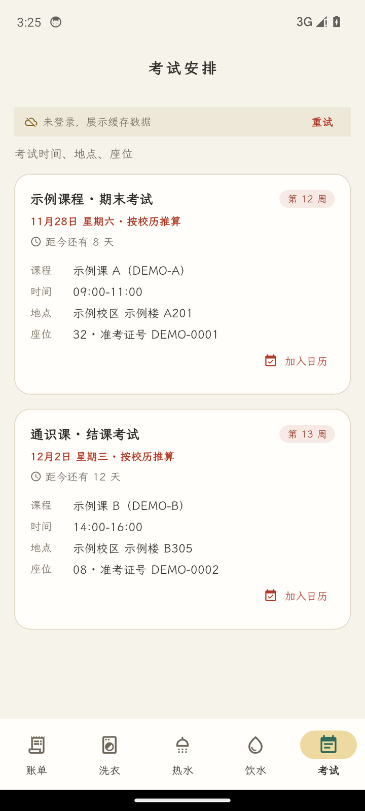
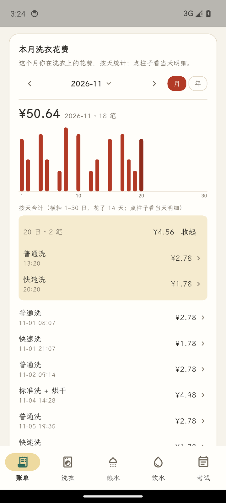
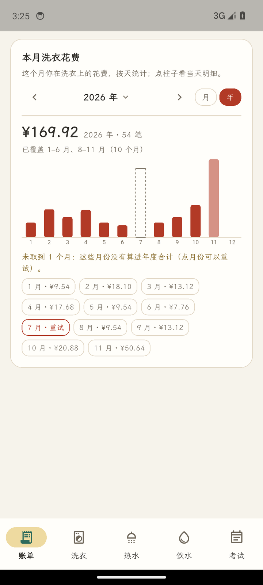
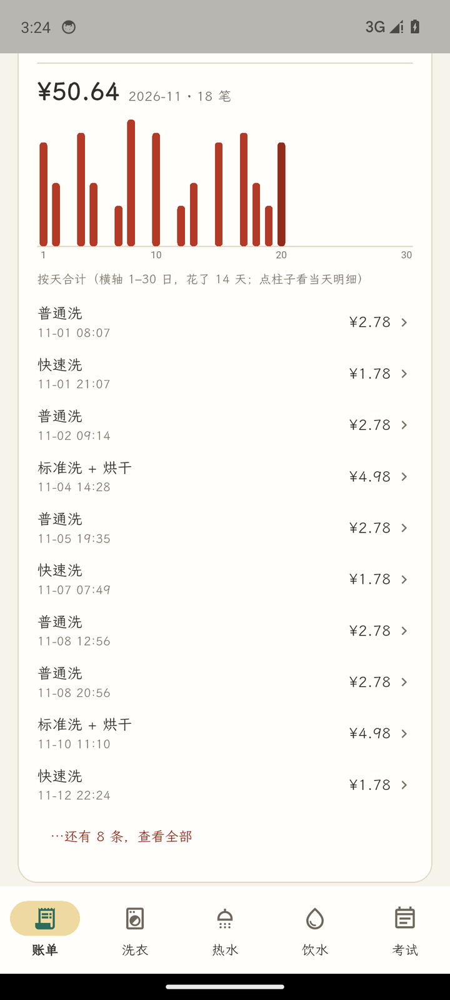

# 南理工紫金学院特供教务助手

**下载安装包** → [Releases](../../releases/latest)

把「课表 / 成绩 / 考试 / 实验室 / 校园生活服务」收进一个 App 的 Android 客户端。数据直连学校既有系统，账号只存在你自己手机里。

> 截图由**模拟器 + 演示数据**生成（示例课名 / 示例楼 / 假金额），不含任何真实账号数据。

## 界面

| 今日看板 | 课表（周视图） | 成绩与绩点 |
| --- | --- | --- |
|  |  |  |

| 作业与截止 | 考试安排 | 通知与提醒 |
| --- | --- | --- |
|  |  |  |

## 生活服务账单

| 月视图（点某天看当天） | 按年看花费（缺月标「未取到」） | 明细默认只留 10 条 |
| --- | --- | --- |
|  |  |  |

> 生活服务三页（洗衣 / 热水 / 饮水）在 1.0.79 已改为「当前机器名 → 开启 → 账单」的极简首屏，新版截图待补。

## 功能

- **今日看板**：今日课程、待评估、作业截止、绩点趋势，一屏看完
- **课表**：周视图（左右翻周）、单双周、自定义课、导出 xlsx
- **成绩**：成绩与不及格查询、GPA 模拟、绩点快照趋势；出新成绩推通知
- **考试**：考试安排、按校历推算日期、加入系统日历；**考试时间一公布就推送**
- **实验室系统**：登录、实验课程、成绩、课程表、实验报告提交（需学校账号，仓库内无截图）
- **作业与截止**：智慧树 / 对分易同步与截止提醒
- **校园网络**：连上校园 Wi-Fi 自动认证（需真实校园网环境，仓库内无截图）
- **校园生活**：洗衣机（U净）、开水/直饮水（胖乖）、洗澡热水（趣智蓝牙）、取快递；历史账单 + 按月/按年花费图表（柱子可点看当天，明细默认只留最近 10 条）
- **桌面小组件 / 通知**：今日课程与小节提醒、状态栏实时活动（系统级，仓库内只放了 App 内设置页截图）

## 安装

- Android 7.0 及以上（minSdk 24），arm64 设备；
- 到 [Releases](../../releases/latest) 下载 `njust-zijin-jiaowu-assistant-<版本>.apk`；
- 覆盖升级即可（签名一致），首次安装需允许「安装未知来源应用」。

## 说明

- 账号密码只写在你自己的手机上（系统密钥库同级），不上传任何服务器；App 直接连学校既有系统，本项目没有自建后端。
- **本仓库只发布安装包与截图，不含源代码。**
- 非官方项目，与学校任何部门无关；学校系统接口变更时相关功能可能临时失效，届时界面会说明原因。

## 反馈

发现 bug 或有功能建议，欢迎开 [Issues](../../issues)。
