

# 青课 · 紫金教务助手

南京理工大学紫金学院同学的教务小工具：课表、成绩、作业、考试、实验室系统、校园网认证，
还有宿舍楼的洗衣机 / 开水 / 洗澡热水 / 取快递。

**一个 App 把「今天要干什么」说清楚。**

[下载最新版](https://github.com/43456-awa/njust-zijin-jiaowu-assistant/releases/latest) ·
[提 Issue](https://github.com/43456-awa/njust-zijin-jiaowu-assistant/issues) ·
[更新记录](https://github.com/43456-awa/njust-zijin-jiaowu-assistant/releases)

Android 7.0 及以上 ｜ 覆盖安装可保留数据 ｜ 这里只有安装包、更新说明和截图

---

---

## 1 · 今日看板

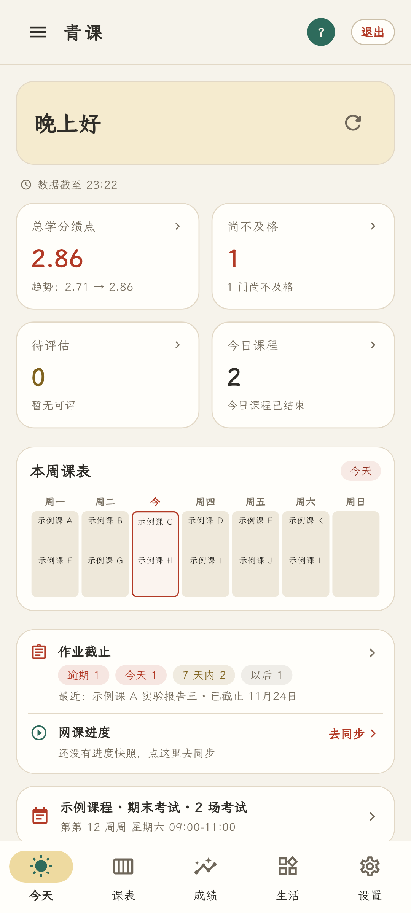

一屏看完今天：**今日课程**、**待评估**、**作业截止**（逾期 / 今天 / 7 天内 / 以后分桶）、
**绩点趋势**（本学期 vs 上学期）。断网时先显示上次的缓存，联网后自己刷新。
底部五个页签就是 App 的主导航：今天 / 课表 / 成绩 / 生活 / 设置。

## 2 · 课表

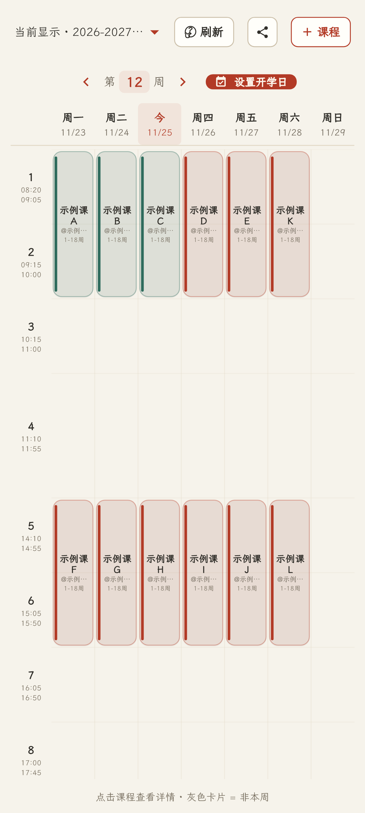
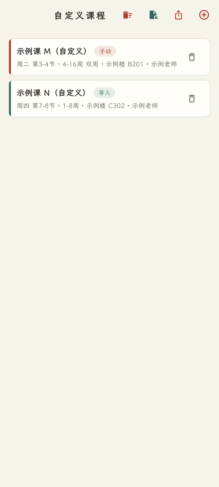

- 周视图：星期 + 日期栏固定，第 1–10 节按时间轴排，**左右翻周**看前后几周；
- 单双周 / 起止周按教务原文显示，非本周的课是灰卡片；
- **自定义课程**：手动加，或从 xlsx 导入（图 2 里「手动 / 导入」两种来源都有）；
  同一格冲突时自定义课覆盖教务课；
- 整周课表可以**导出成图片**分享（工具条上的分享按钮）；
- 顶部那条「展示缓存数据」是断网时的老实提示——离线也能看课表。

## 3 · 成绩

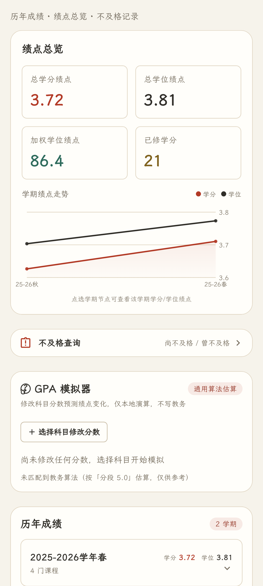
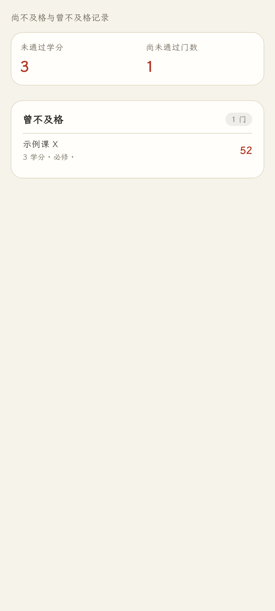

- 成绩单按学期折叠，学分 / 学位课绩点 / 加权学位绩点分开算；
- **绩点快照趋势**：每次查完成绩留一个快照，点学期节点看当时的学分与绩点；
- **GPA 模拟器**：改某几门课的分数预测绩点变化，纯本地演算，不回写教务；
- **不及格查询**：尚未通过 / 曾不及格分开列，未通过学分单独计；
- 出新成绩会推一条通知（系统通知，截图里拍不到）。

## 4 · 考试

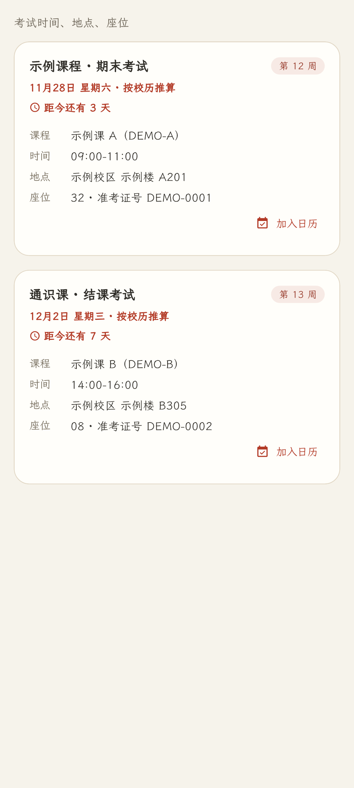

- 考试时间、地点、座位、准考证号一次列全；
- 教务只给「第 12 周 星期六」这种相对时间时，按**校历推算**成具体日期，并显示「距今还有 N 天」；
- 一键**加入系统日历**（带地点与提前提醒）；
- 考试时间一公布就推通知。

## 5 · 实验室系统（已登录，需学校账号）

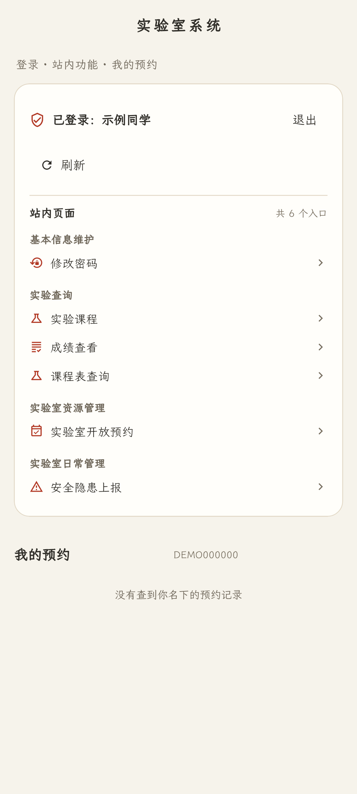

登录之后这一页就是站内界面：左上「已登录：<账号>」、下面按站点原文分组的菜单
（实验课程 / 成绩查看 / 课程表查询 / 实验室开放预约 / 安全隐患上报 …），点进去是原生页。

- 账号是学号，密码是实验室系统自己那套（和教务密码不是一个）；
- 点一次「登录」，验证码自动取、自动识别、自动提交，验证码错会自己重试，不用盯着图看；
- 登录后**这一页就是站内界面**：实验课程、成绩、课程表、报告提交都是原生页，不用啃网页版；
- 报告提交会核对站点表单字段，只发一次、不自动重试（避免交重）。

> 实验室系统（已登录，需学校账号；**界面演示**）：账号是学校实验室系统那套，仓库里放的是假数据，
> 用户名写成「示例同学」，没有任何真实姓名或学号。

## 6 · 作业与截止

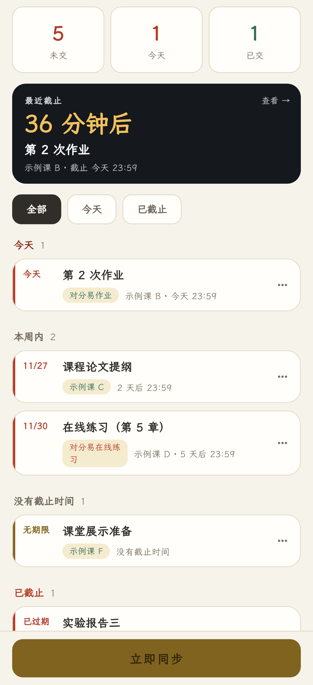

- **智慧树（学习通）/ 对分易**的作业同步到一个台账，手记的也能加；
- 按「逾期 / 今天 / 本周内 / 没有截止时间」分组，最近一个截止单独放最大那张卡；
- 截止前推提醒，可一键加入日历；
- 只做提醒与记录：**不代交、不抓答案**，要交作业请打开对应 App。

## 7 · 校园网络（需真实校园网，本仓库无截图）

连上校园 Wi-Fi 后，网关会把网页请求拦到认证门户，App 确认「确实被拦了」之后才动，
省得在正常网络下白跑一趟；随后**帮你把账号密码填好并登录**。

- 可选运营商（自动 / 校园网 / 移动 / 联通 / 电信），选「自动」就用门户标为默认的那个；
- 验证码不行就在弹窗里手填一次，填完继续，不用重来；
- 开了「自动认证」后，Wi-Fi 一接上就静默试一次，失败了不打扰，可以手动重试。

> 这一节**没有配图**：真实认证必须在校园网环境里、对着学校的门户才跑得出来，
> 拿假状态摆一张图反而会让人以为能这么用。
> 另外 Android 不允许 App 自己连 Wi-Fi —— 连热点这一步在系统设置里完成，App 只负责门户认证。

## 8 · 校园生活

**历史账单**：洗衣 / 开水 / 洗澡热水三家都能查。按月看每天花了多少，**点柱子看当天明细**；
明细默认只留**最近 10 条**，剩下的点「查看全部」；切到「年」看 12 个月的柱状图，
哪个月没取到就老实写「**未取到 N 个月**」，并且不计入年度合计（不拿 0 糊弄你）。

三台机器的整页 —— 机器卡 → 本月花费（合计 + 按天柱 + 明细） → 高级 · 诊断：

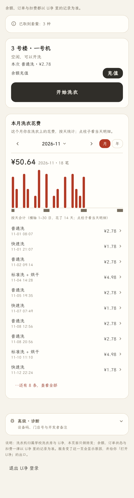
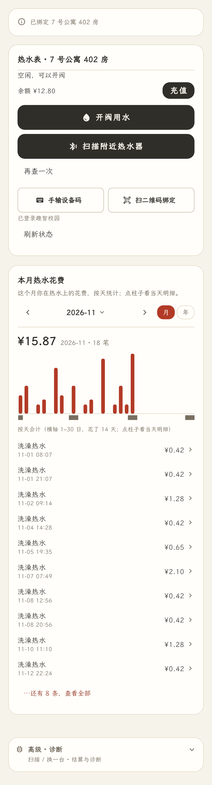
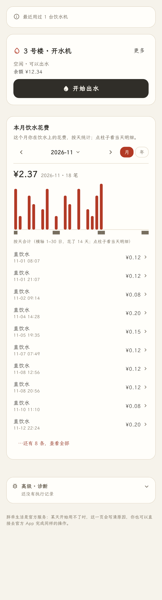

- **洗衣机（U净）**：扫机器码 → 选套餐 → 开洗，余额与订单以 U净 为准；
- **洗澡热水（趣智）**：蓝牙扫附近热水表 → 绑定 → 开阀 / 停水，实时看用量与结算；
- **开水 / 直饮水（胖乖）**：扫码出水，实时看余额。

**取快递**：平台入口 + 取件面板。

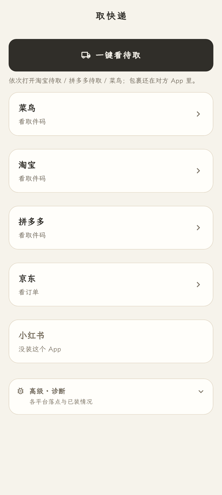
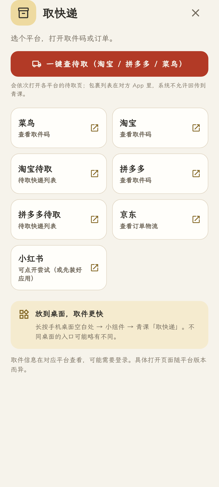

- 一键依次打开淘宝待取 / 拼多多待取 / 菜鸟的待取页；
- 菜鸟、淘宝、拼多多直达**取件码**，京东 / 小红书看订单；
- 包裹列表与取件码在对方 App 里（Android 不允许跨 App 读取），青课负责把你送过去。

> 这一组是**界面演示**：机器卡、按钮、账单卡都是真实组件，账单里显示的是演示数据。

## 9 · 桌面小组件与通知

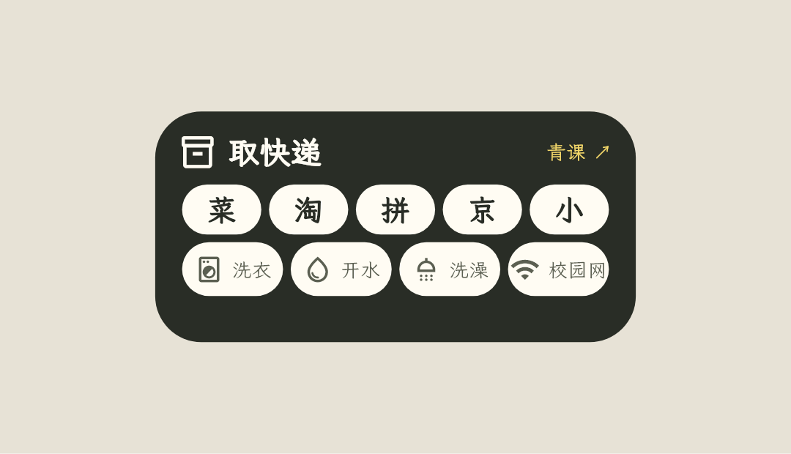

小组件样式（与桌面 **4×2** 尺寸一致：250dp × 120dp，底色与圆角、平台字标、
洗衣 / 开水 / 洗澡 / 校园网快捷行都是原生那份版式的 1:1 复刻；
系统级 AppWidget 由 Android 渲染，此处为同版式渲染图）。

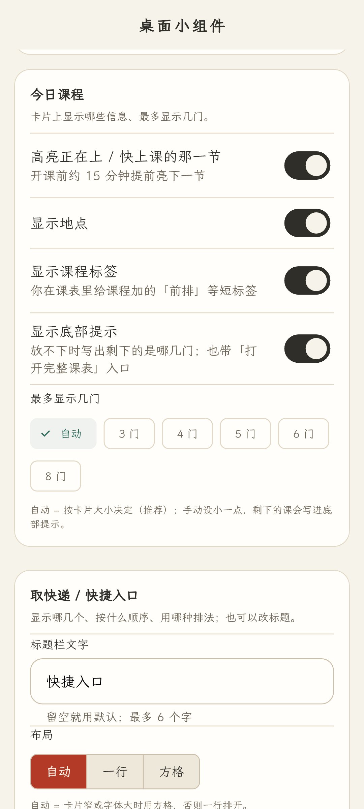

- 卡片上显示什么、最多显示几门，都能在 App 里调；可跟随系统动态取色（Android 12+）；
- **小节提醒**：上课前按节次推提醒；
- **状态栏实时活动**：正在上课时在状态栏显示当前 / 下一节（系统级胶囊，截图拍不到）。

## 10 · 三套外观

默认是**纸墨朱砂**（上面所有图都是它）。设置 → 外观里还能换：

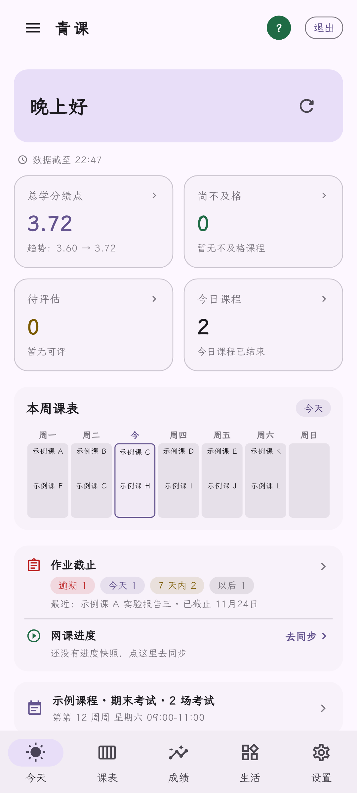
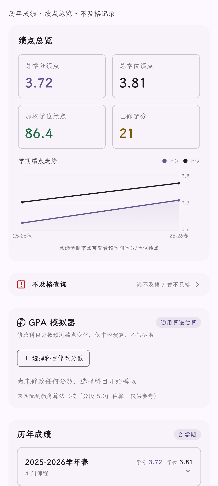
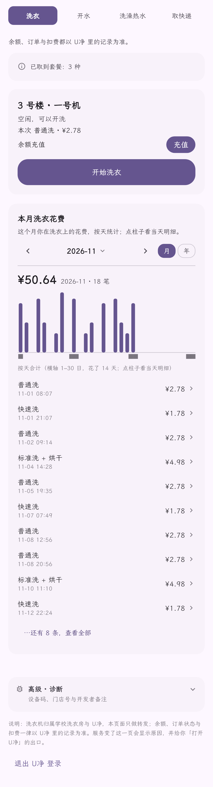

**Material 3 主题（设置 → 外观 → Material 风格）**：M3 baseline 那套紫，
组件形态、圆角、动效都按 Material 3 走；颜色一律取自主题的 colorScheme，没有单独手调。
（第三套「液态玻璃」是近黑单色 + iOS 蓝，本仓库暂不放图。）

---

## 安装

1. 打开 [Releases](https://github.com/43456-awa/njust-zijin-jiaowu-assistant/releases/latest)，
   下载最新的 `.apk`；
2. 手机上允许「安装未知来源应用」，点开装；
3. 首次打开按提示填教务系统（或 VPN）账号 —— 账号只存在本机，不上传任何服务器；
4. 后续版本**覆盖安装**即可，本地数据（课表缓存、作业台账、账单）都保留。

## 常见问题

**连热水表一直失败？** 热水表同时只允许一台手机连着。先在别的手机上断开（或关掉那边 App），
再用这台扫一次；扫不到就开一下手机定位权限（Android 的蓝牙扫描要它）。

**课表 / 成绩是空的？** 教务系统入口换了或者登录过期了，去设置里重登一次。
断网时显示的是上次缓存，会有一条「展示缓存数据」的提示。

**实验室系统进不去？** 这个模块要学校实验室系统的账号，和教务账号不是一套；
学校放假或站点维护时也会打不开，页面会写清是哪一步失败的。

**会不会上传我的成绩？** 不会。所有数据只在本机，App 只直连学校站点。

## 反馈

用着不顺手、发现 bug、想要新功能，都欢迎
[提 Issue](https://github.com/43456-awa/njust-zijin-jiaowu-assistant/issues/new/choose)：
写清手机型号、Android 版本、哪一步出的问题（截图更好），能快很多。
